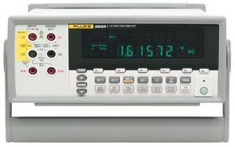

# Fluke8808A

{.lead}
A driver for [`InstroDMM`](/dmm.md) (unstable)

{.driver-image}

The {py:obj}`Fluke8808A <instro.unstable.dmm.drivers.fluke_8808a.Fluke8808A>` provides a driver that can be used to instantiate an [InstroDMM](/dmm.md). It ships in the `instro-unstable` package (`pip install 'instro[unstable]'`) while its API settles.

The 8808A's only remote interface is its RS-232 port, which instro reaches as a VISA `ASRL` resource. The meter speaks a Fluke 45-style command set rather than SCPI. The driver reads the primary display only and supports DC/AC voltage, DC/AC current, 2- and 4-wire resistance, range, and digits.

## Behavior to know

- **Front panel locked while connected.** `open()` resets the meter (`*RST`) and locks the front panel, so the function the driver tracks can't change underneath it. `close()` returns the meter to local control.
- **Ranges apply to the active function.** Select the function first (`set_measurement_function`, or any `read_*` call), then set its range. Setting a range for another function raises an error. A range value picks the smallest range whose full scale covers it; `None` selects autorange.
- **Two resolutions.** `set_digits(5)` selects the slow rate (2.5 readings/s); `set_digits(4)` selects the fast rate (100 readings/s). Other values raise `ValueError`.
- **Overload.** A reading over range (`0L` on the display) comes back as ±1.0E+9.

## Serial settings

The driver's serial defaults are 9600 baud, 8 data bits, no parity, 1 stop bit, and no flow control, which match the meter's factory RS-232 setup. To use other settings, pass a {py:class}`~instro.lib.transports.VisaConfig` with a matching {py:class}`~instro.lib.transports.SerialConfig` instead of a resource string.

The driver works with the meter's Echo setting on or off: on `open()` it checks whether the meter answers each command with a prompt and adapts to it.

## Creating an [`InstroDMM`](/dmm.md) with {py:obj}`Fluke8808A <instro.unstable.dmm.drivers.fluke_8808a.Fluke8808A>`

```python
from instro.unstable.dmm.drivers import Fluke8808A
from instro import InstroDMM

dmm = InstroDMM(
    name="myDMM",
    driver=Fluke8808A("ASRL/dev/ttyUSB0::INSTR"),
)
```

Parameters and methods specific to {py:obj}`Fluke8808A <instro.unstable.dmm.drivers.fluke_8808a.Fluke8808A>` can be found in the [Reference](/ref/index.md).
