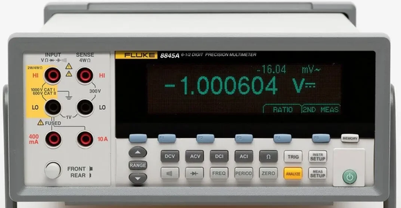

# Fluke8845A

{.lead}
A driver for [`InstroDMM`](/dmm.md) (unstable)

{.driver-image}

The {py:obj}`Fluke8845A <instro.unstable.dmm.drivers.fluke_8845a.Fluke8845A>` provides a driver that can be used to instantiate an [InstroDMM](/dmm.md). It ships in the `instro-unstable` package (`pip install 'instro[unstable]'`) while its API settles.

The 8845A's default `8845` command set is compatible with the Agilent 34401A, so this driver runs the {py:obj}`Agilent34401A <instro.dmm.drivers.agilent_a34401a.Agilent34401A>` driver unchanged. It supports the same functions: DC/AC voltage, DC/AC current, 2- and 4-wire resistance, range, and digits.

## Meter setup

Make these settings on the meter's front panel before connecting. Neither can be changed over the remote interface, and the meter keeps both through a power cycle.

:::{warning}
The meter must use the **`8845`** command set. The driver sends Agilent 34401A commands, which the Fluke 45 emulation command set does not accept.
:::

::::{container} steps

:::{container} step
**Select the `8845` command set.** Press **INSTR SETUP**, then **COMMANDS**, then **8845**.
:::

:::{container} step
**Over RS-232, select `COMPUTER` mode.** Press **INSTR SETUP**, **PORT IF**, **RS232**, **COMP/TERM ECHO**, then **COMPUTER**. In `TERMINAL` mode the meter echoes every command and prints a `NNN>` prompt, which the driver reads as the reply, so `open()` fails with an error like `Agilent 34401A reported error: *CLS`.
:::

:::{container} step
**Over RS-232, match the serial line to instro's defaults.** In the same RS232 menu, set **BAUD RATE** to 9600, **PARITY DATA BIT** to NONE 8B DATA, **FLOW CONTROL** to NONE, and **EOL** to CR LF. The meter always uses 1 stop bit. To use other settings, pass a {py:class}`~instro.lib.transports.VisaConfig` with a matching {py:class}`~instro.lib.transports.SerialConfig` instead of a resource string.
:::

::::

Error messages from this driver name the Agilent 34401A, because its error checking is inherited unchanged.

## Creating an [`InstroDMM`](/dmm.md) with {py:obj}`Fluke8845A <instro.unstable.dmm.drivers.fluke_8845a.Fluke8845A>`

```python
from instro.unstable.dmm.drivers import Fluke8845A
from instro.dmm import InstroDMM

dmm = InstroDMM(
    name="myDMM",
    driver=Fluke8845A("ASRL6::INSTR"),
)
```

Parameters and methods specific to {py:obj}`Fluke8845A <instro.unstable.dmm.drivers.fluke_8845a.Fluke8845A>` can be found in the [SDK](/sdk/index.md).
