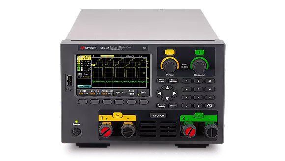

# KeysightEL30000

{.lead}
A driver for [`InstroELoad`](/eload.md)

{.driver-image}

The {py:obj}`KeysightEL30000 <instro.eload.drivers.keysight_el30000.KeysightEL30000>` provides a driver that can be used to instantiate an [InstroELoad](/eload.md).

## Creating an [`InstroELoad`](/eload.md) with {py:obj}`KeysightEL30000 <instro.eload.drivers.keysight_el30000.KeysightEL30000>`

```python
from instro.eload.drivers import KeysightEL30000
from instro.eload import InstroELoad

eload = InstroELoad(
    name="myELoad",
    driver=KeysightEL30000(visa_resource="USB0::0x2A8D::0x3902::MY12345678::INSTR"),
)
```

Parameters and methods specific to {py:obj}`KeysightEL30000 <instro.eload.drivers.keysight_el30000.KeysightEL30000>` can be found in the [SDK](/sdk/index.md).
