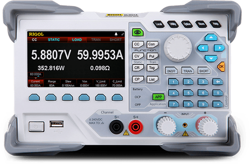

# RigolDL30xx

{.lead}
A driver for [`InstroELoad`](/eload.md)

{.driver-image}

The {py:obj}`RigolDL30xx <instro.eload.drivers.rigol_dl30xx.RigolDL30xx>` provides a driver that can be used to instantiate an [InstroELoad](/eload.md).

## Creating an [`InstroELoad`](/eload.md) with {py:obj}`RigolDL30xx <instro.eload.drivers.rigol_dl30xx.RigolDL30xx>`

```python
from instro.eload.drivers import RigolDL30xx
from instro.eload import InstroELoad

eload = InstroELoad(
    name="myELoad",
    driver=RigolDL30xx(visa_resource="USB0::0x1AB1::0x0E11::DL3D000000000::INSTR"),
)
```

Parameters and methods specific to {py:obj}`RigolDL30xx <instro.eload.drivers.rigol_dl30xx.RigolDL30xx>` can be found in the [SDK](/sdk/index.md).
