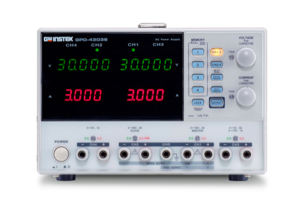

# GWInstekGPD3303

{.lead}
A driver for [`InstroPSU`](/psu.md)

{.driver-image}

The {py:obj}`GWInstekGPD3303 <instro.psu.drivers.gw_instek_gpd3303.GWInstekGPD3303>` provides a driver that can be used to instantiate an [InstroPSU](/psu.md).

## Creating an [`InstroPSU`](/psu.md) with {py:obj}`GWInstekGPD3303 <instro.psu.drivers.gw_instek_gpd3303.GWInstekGPD3303>`

```python
from instro.psu.drivers import GWInstekGPD3303
from instro.psu import InstroPSU

psu = InstroPSU(
    name="myPSU",
    driver=GWInstekGPD3303(visa_resource="ASRL3::INSTR"),
    num_channels=2,
)
```

The GPD-3303D has a single output switch, so `output_enable` turns every channel on or off together and `get_output_status` reports that shared state. Channel 3 (the fixed output) cannot be programmed.

Parameters and methods specific to {py:obj}`GWInstekGPD3303 <instro.psu.drivers.gw_instek_gpd3303.GWInstekGPD3303>` can be found in the [SDK](/sdk/index.md).
