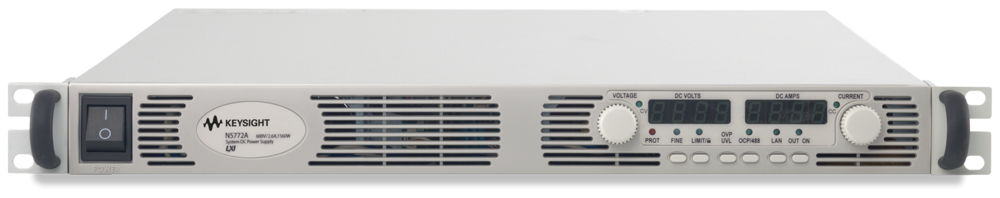

# KeysightN5700

{.lead}
A driver for [`InstroPSU`](/psu.md)

{.driver-image}

The {py:obj}`KeysightN5700 <instro.psu.drivers.keysight_n5700.KeysightN5700>` provides a driver that can be used to instantiate an [InstroPSU](/psu.md). It uses the SCPI interface of the [TDK Lambda Genesys](TDKLambdaGenesys.md) driver.

## Creating an [`InstroPSU`](/psu.md) with {py:obj}`KeysightN5700 <instro.psu.drivers.keysight_n5700.KeysightN5700>`

```python
from instro.psu.drivers import KeysightN5700
from instro.psu import InstroPSU

psu = InstroPSU(
    name="myPSU",
    driver=KeysightN5700(visa_resource="USB0::..."),
    num_channels=1,
)
```

Parameters and methods specific to {py:obj}`KeysightN5700 <instro.psu.drivers.keysight_n5700.KeysightN5700>` can be found in the [SDK](/sdk/index.md).
