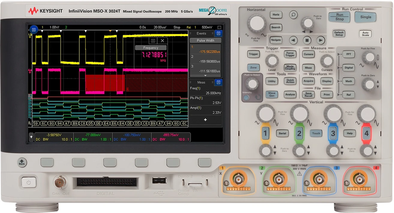

# Keysight3000TX

{.lead}
A driver for [`InstroScope`](/scope.md) (unstable)

{.driver-image}

The {py:obj}`Keysight3000TX <instro.unstable.scope.drivers.keysight_3000tx.Keysight3000TX>` provides a driver that can be used to instantiate an [InstroScope](/scope.md). It ships in the `instro-unstable` package (`pip install 'instro[unstable]'`) while its API settles.

## Creating an [`InstroScope`](/scope.md) with {py:obj}`Keysight3000TX <instro.unstable.scope.drivers.keysight_3000tx.Keysight3000TX>`

```python
from instro.unstable.scope.drivers import Keysight3000TX
from instro.scope import InstroScope

scope = InstroScope(
    name="myScope",
    driver=Keysight3000TX("<visa_resource>"),
    num_channels=4,
)
```

Parameters and methods specific to {py:obj}`Keysight3000TX <instro.unstable.scope.drivers.keysight_3000tx.Keysight3000TX>` can be found in the [SDK](/sdk/index.md).
