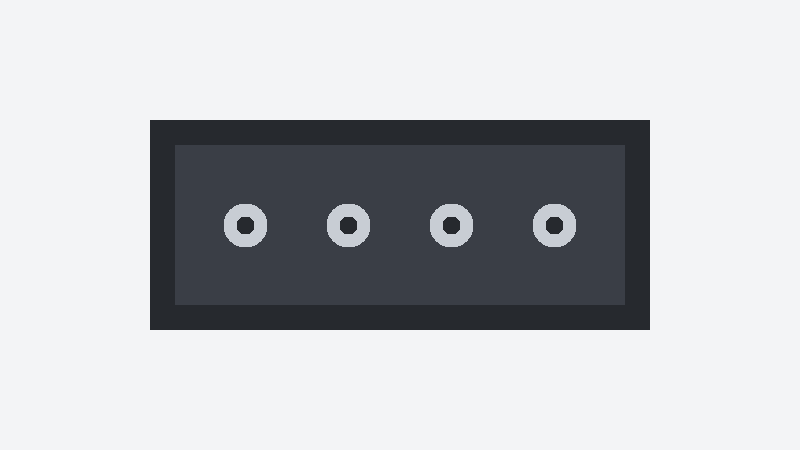

# SaleaeLogicMSO

{.lead}
A driver for [`InstroScope`](/scope.md) (unstable)

{.driver-image}

The {py:obj}`SaleaeLogicMSO <instro.unstable.scope.drivers.saleae_logic_mso.SaleaeLogicMSO>` provides a driver for the analog channels of a Saleae Logic MSO, used to instantiate an [InstroScope](/scope.md).

It ships in the `instro-unstable` package (`pip install 'instro[unstable]'`) while its API settles.

The driver talks to the device through Saleae's `saleae-mso-api` package, which instro does not install for you. Saleae publishes it on its own package index rather than PyPI (the PyPI project of that name is an empty placeholder), so install it from there:

```bash
pip install saleae-mso-api --extra-index-url https://downloads.saleae.com/pypi
```

Saleae's API needs the Logic 2 software installed for its USB drivers (Windows) or udev rules (Linux); Logic 2 doesn't have to be running.

## Creating an [`InstroScope`](/scope.md) with {py:obj}`SaleaeLogicMSO <instro.unstable.scope.drivers.saleae_logic_mso.SaleaeLogicMSO>`

```python
from instro.unstable.scope.drivers import SaleaeLogicMSO
from instro import InstroScope

scope = InstroScope(
    name="myScope",
    driver=SaleaeLogicMSO(),  # or SaleaeLogicMSO(serial_number="<serial>")
    num_channels=4,
)
```

Construct the driver directly in Python, as above. `instro discover` doesn't find the MSO, since it isn't a VISA instrument.

## How it differs from a benchtop scope

The Logic MSO has no front panel, and Saleae's API takes one blocking, triggered capture at a time. The driver keeps every setting and sends them all with each capture:

- `single()` arms a capture, and `fetch_waveform()` or `measure()` runs it, waiting up to its `timeout` for the trigger. Read the data that way instead of polling `get_acquisition_state()`, which reports `RUNNING` until the capture has run.
- Vertical scale is sent as a full-scale range of 8 divisions; horizontal scale sets a capture window of 10 divisions, centered on the trigger.
- The sample rate gives about 100,000 samples per channel over the window, up to the device maximum.
- Measurements are computed on the host from the captured waveform.
- DC coupling, 1x or 10x probes, rising or falling edge triggers, and the NORMAL trigger mode only. Free-running acquisition, averaging, force trigger, trigger status, screenshots, and saved setups raise `NotImplementedError`.
- Digital channels aren't captured.

Parameters and methods specific to {py:obj}`SaleaeLogicMSO <instro.unstable.scope.drivers.saleae_logic_mso.SaleaeLogicMSO>` can be found in the [Reference](/ref/index.md).
