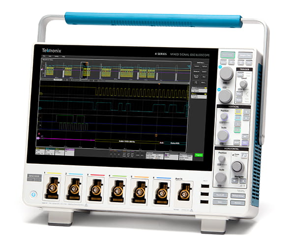

# Tektronix4SeriesMSO

{.lead}
A driver for [`InstroScope`](/scope.md)

{.driver-image}

The {py:obj}`Tektronix4SeriesMSO <instro.scope.drivers.tektronix_4series.Tektronix4SeriesMSO>` provides a driver that can be used to instantiate an [InstroScope](/scope.md).

## Creating an [`InstroScope`](/scope.md) with {py:obj}`Tektronix4SeriesMSO <instro.scope.drivers.tektronix_4series.Tektronix4SeriesMSO>`

The {py:obj}`Tektronix4SeriesMSO <instro.scope.drivers.tektronix_4series.Tektronix4SeriesMSO>` owns the one VISA connection and vends a `.scope` view for [`InstroScope`](/scope.md) and an `.awg` view for the built-in AFG (see [InstroAWG](/awg.md)).

```python
from instro.scope.drivers import Tektronix4SeriesMSO
from instro.scope import InstroScope

device = Tektronix4SeriesMSO("<visa_resource>")
scope = InstroScope(
    name="myScope",
    driver=device.scope,
    num_channels=4,
)
```

## Period and duty-cycle measurements

The scope computes `PERIOD`, `FREQUENCY` and `DUTY_CYCLE` per cycle, and a cycle needs two adjacent same-direction edges inside the acquisition. If the timebase shows fewer than two rising edges (for example, one period exactly centered on the trigger), `measure` returns `NaN` for `DUTY_CYCLE` even when width measurements still work. Widen the timebase to show at least two or three periods.

## Roll mode

At slow timebases (on the MSO44B, from about 0.1 s/div) the scope rolls: it acquires continuously with no trigger and no dead time between records. `HORizontal:ROLL?` reports it. In roll mode `fetch_waveform` returns times relative to the newest sample (`t = 0`), not a trigger, so a free-running fetch is never stamped into the future. A daemon that calls `fetch_waveform` with `background_interval` equal to the window length (ten divisions) streams the signal with only tens of milliseconds of overlap or gap between windows.

## FastFrame

The driver never turns FastFrame on or off; configure it on the instrument. When the scope is in FastFrame mode, `fetch_waveform` reads every frame in one transfer and puts them on a single timeline built from the scope's per-frame trigger timestamps, with `t = 0` at the last frame's trigger, so earlier frames have negative times. FastFrame must be off for roll mode, and the scope keeps its FastFrame setting across sessions.

Parameters and methods specific to {py:obj}`Tektronix4SeriesMSO <instro.scope.drivers.tektronix_4series.Tektronix4SeriesMSO>` can be found in the [SDK](/sdk/index.md).
